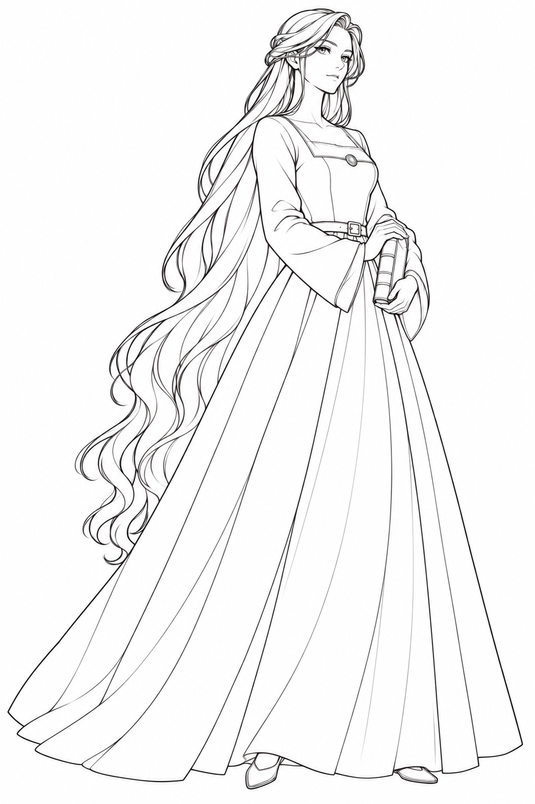
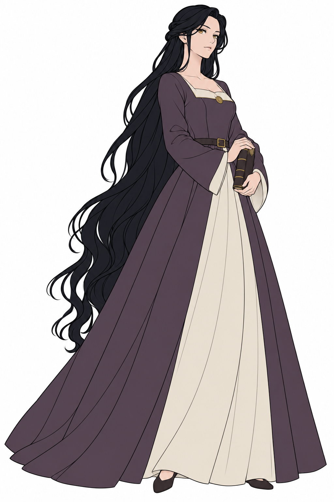
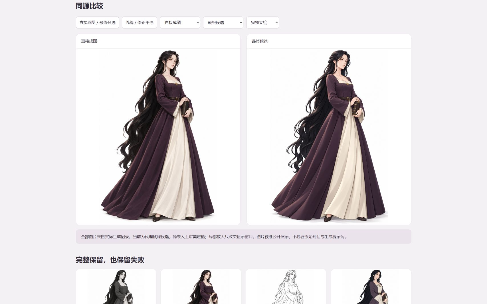

# 角色插画工作流

**把每一轮插画选择、参考关系和修正原因，保存成可检查的项目记录。**

面向使用图像生成工具的角色创作者：先明确设计目标，再逐阶段审阅；保留失败候选、提示词版本与参考哈希，用离线页面比较结果。

当前版本：`0.1.0-rc.1`，本地发布候选。项目尚未指定开源许可证。

<p align="center">
  
  
  
</p>

真实案例输出：线稿 → 修正平涂 → 最终候选。图片获准展示，尚未代表人工审美定稿。打开[交互比较页](examples/noble-lady/index.html)查看全部 8 张，包括两张失败候选；在 GitHub 阅读时请下载仓库并按下方命令预览 HTML。

<details>
<summary>查看实际比较页截图（Edge）</summary>



</details>

## 解决什么问题

多轮生成容易混淆当前选中版本、实际参考图和提示词修改。这个项目将这些信息存入 JSON/JSONL：上游改选会标记下游过期，参考改变会触发校验，失败结果保留而不覆盖。

## 核心能力

- **逐阶段审阅**：默认 `review`，选择需提供人工证据文件；显式 `--demo` 才记录代理试跑选择。
- **两种路线**：从动作／结构逐步绘制，或先完整成图再转线稿、配色、光影和精修。
- **参考与版本检查**：生成前固定阶段参考、顺序与 SHA-256；修改未生成提示词时保留旧版本。
- **失败与修正记录**：QA 硬失败阻止选定，修正使用新 ID，支持数量限制和下游失效标记。
- **离线比较**：通用页面展示阶段记录；先成图路线支持原图叠加。公开贵族案例另有切换与局部缩放。
- **参考算法模块**：保留固定种子筛选和目录校验函数及测试；私有图库与采集 CLI 不随发行提供。

工具只管理记录和页面，**不包含图像生成后端**。实际图像由外部工具生成后导入；没有“执行一个命令自动画完整角色”的接口。

## 环境与快速开始

技术栈为 Node.js ES Modules、JSON/JSONL、原生 HTML/CSS/JavaScript。核心无第三方 npm 运行时依赖。使用 **Node.js 24.x**；本地已在 Windows、Node 24.19.0 验证，其他平台的 CI 配置尚待远程运行。

取得仓库目录后，在根目录执行：

```sh
npm ci --ignore-scripts
npm test
npm run check
npm run preview
```

打开 <http://127.0.0.1:8776> 浏览贵族案例，使用 `Ctrl+C` 停止。页面也可直接离线打开。无需 API Key 即可运行测试和浏览案例；实际生图能力由所用外部工具决定。

## 新建自己的项目

以下配方是重新编写的通用示例，**不是公开案例的原始提示词**。先复制并编辑配方中的角色、用途和各阶段指令，再初始化。`assets/project-template.json` 是状态模板，不是可传给 `--recipe` 的配方。

```sh
node tools/deliver.mjs --run runs/my-character init --recipe tools/recipes-v3.json
node tools/deliver.mjs --run runs/my-character prepare DIRECT_V3
node tools/deliver.mjs --run runs/my-character prompt DIRECT_V3
node tools/deliver.mjs --run runs/my-character status
node tools/deliver.mjs --run runs/my-character render
```

下一步是在外部图像工具中使用提示词和已准备的参考，然后按[记录命令指南](skills/character-illustration-workflow/references/records.md)执行 `ingest → qa → select`。后续阶段再次 `prepare`。上面的 `render` 可显示尚未生成的项目，不会代替生图。

`runs/` 默认忽略。每个新角色使用新目录；`init` 拒绝覆盖已存在的记录。请始终显式指定 `--run`；省略时沿用兼容性默认目录 `demo-postal-girl/`，它也默认忽略。

## 在助手中使用 Skill

让支持读取项目文件的助手阅读 `skills/character-illustration-workflow/SKILL.md`，提供角色属性、用途与实际图像工具，按默认 review 模式逐阶段推进。此仓库不会自动安装全局 Skill。Skill 可以指导记录流程，但不会给助手增加原本不存在的生图能力。

## 目录

| 路径 | 用途 |
|---|---|
| `skills/character-illustration-workflow/` | 流程说明、检查规则和状态模板 |
| `tools/deliver.mjs` | 记录 CLI 与状态校验 |
| `tools/gallery-v2.mjs` | schema 2 两条路线的页面生成器，文件名保留兼容 |
| `tools/reference-core.mjs` | 可选参考筛选／校验函数 |
| `tools/recipes*.json` | 通用示例配方 |
| `examples/noble-lady/` | 获准公开的图片与精简展示页 |
| `tests/` | 状态、参考算法与发布回归测试；独立合成图片 fixture |
| `docs/` | 架构、限制与发布范围说明 |

## 当前状态与限制

这是可运行的文件工作流工具，尚不是稳定公共 API。通用页面按项目标题生成，但不复刻所有历史批次的专用交互。公开案例是精简展示，不能作为完整 CLI 项目继续生成。

本地记录的一致性不证明外部工具确实接收了图片，也不能认证人工证据文件的作者。图片质量、审美定稿和第三方素材许可需要独立判断；不提供可编辑 PSD/KRA，不保证逐像素保持或相同模型输出。更多边界见[已知限制](docs/limitations.md)。

## 反馈与贡献

欢迎通过 Issue 描述复现步骤、期望与实际结果；不要附带密钥、私人原图、用户原始对话或机器路径。提交改动前运行 `npm test` 和 `npm run check`。许可证未确定前，请先与维护者讨论外部代码／素材贡献的授权安排。

## 许可证与素材

**许可证暂未指定，仓库不附 LICENSE，也不宣称已授予开源许可。** 贵族案例图片由维护者批准在本项目展示，此批准不是向第三方提供通用再授权。第三方参考库、原始对话、完整提示词和本机来源路径均不包含在发行范围内。详见[素材说明](examples/noble-lady/README.md)。

## 宣传视频

尚未制作。仓库发布完成后再编写脚本与分镜，经单独审批后制作；当前无视频链接或效果承诺。
